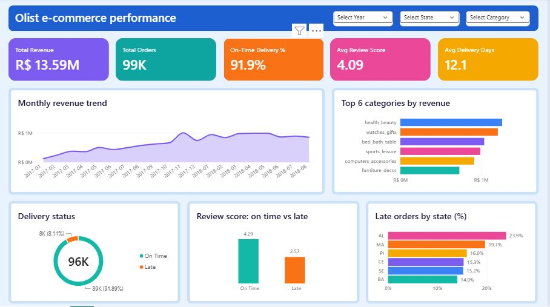
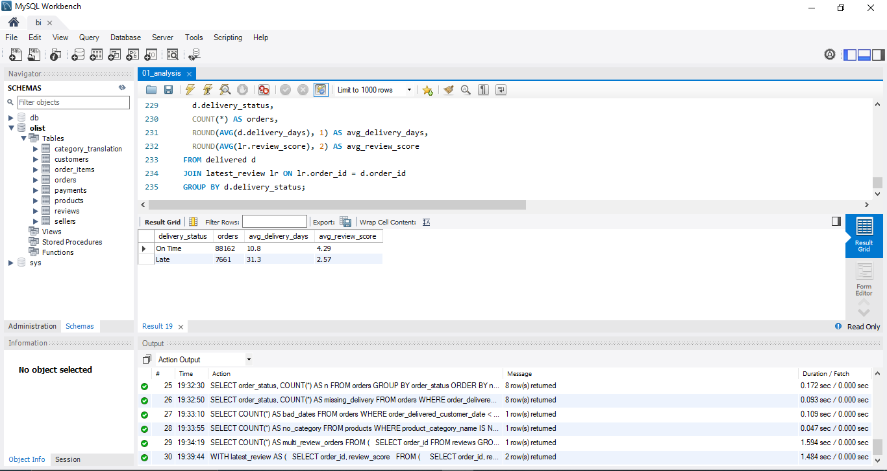
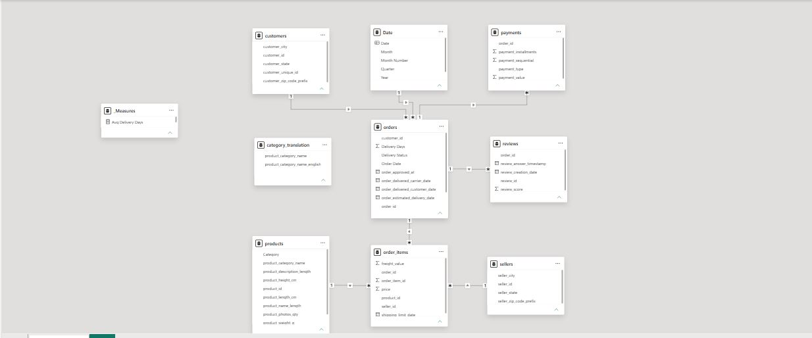

# Olist E-Commerce Analysis (SQL + Power BI)

End-to-end analysis of 100K Brazilian e-commerce orders: MySQL for loading and
quality checks, Power Query for cleaning, a star-style data model and DAX
measures in Power BI, and an executive dashboard.

## Business problem
Which product categories and regions drive revenue, and where are late
deliveries hurting customer satisfaction?

## Tools
MySQL, Power BI (Power Query, DAX), GitHub

## Dataset
Brazilian E-Commerce Public Dataset by Olist (Kaggle): about 100K orders
across 8 tables, 2016 to 2018.

## Dashboard

## Key findings
- Total revenue is about R$13.6M across about 99K orders.
- 91.9% of delivered orders arrive on time, but 7,826 arrive late.
- Late orders average 2.57 stars versus 4.29 for on-time orders, a gap of
  about 1.7 points.
- Late deliveries concentrate in the northeast: AL (23.9%), MA (19.7%),
  PI (16.0%), CE (15.3%) and SE (15.2%).
- Revenue grew through 2017 and levelled off in 2018.
- Top categories by revenue: health_beauty, watches_gifts, bed_bath_table.

## Recommendations
- Review logistics partners and delivery promises for the northeast states.
- Set more realistic estimated delivery dates in high-delay regions.
- Track late-delivery rate by state as a monthly KPI.

## Approach
1. Loaded the CSVs into MySQL and verified row counts for every table.
2. Ran data quality checks (status mix, missing delivery dates, duplicate
   reviews, uncategorised products). See data_quality_notes.md.
3. Cleaned the data in Power Query: translated category names, deduplicated
   reviews to the latest per order, and added Delivery Days and Delivery Status.
4. Built a data model with a Date table and one-to-many relationships.
5. Wrote DAX measures: revenue, orders, on-time %, late %, review score.
6. Designed the dashboard with slicers, KPI cards and five charts.

## SQL analysis
Delivery vs review score, calculated in MySQL (on-time vs late):

## Data model

orders and order_items are the two fact-like tables: orders holds order-level
facts (status, delivery dates) and order_items holds line-level revenue.
customers, products, sellers and Date are dimensions. Relationships are
one-to-many with single-direction filters.

## Notes and limitations
- Late delivery is associated with lower reviews. This does not prove it is
  the only cause.
- The SQL analysis counted 7,661 late orders (only those with a review). The
  Power BI dashboard counts 7,826 (all delivered late orders).
- 2016 and Sept 2018 are excluded from the trend because the dataset has very
  few orders in those months.
- Raw CSV files are not included. Download them from Kaggle (Olist dataset).

## Repository structure
- sql/ : table creation, loading and analysis queries
- powerbi/ : dashboard file (.pbix)
- screenshots/ : query, model and dashboard images
- data_quality_notes.md : data checks and cleaning decisions